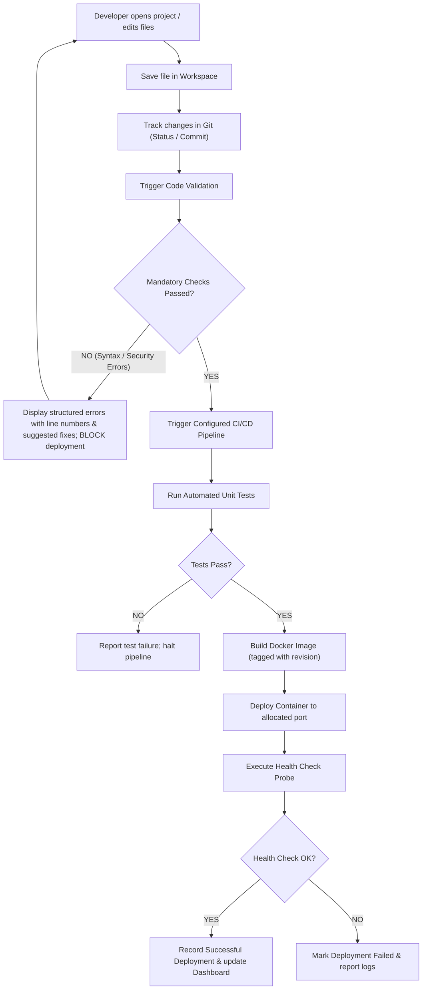

# System Architecture & Integration Plan: Automator + Collaborative Workspace

## 1. Executive Summary

This document presents the detailed architectural inspection (Phase 1) and integration blueprint (Phase 2) to unify **Automator** and **Collaborative Workspace** into a single, cohesive, production-grade developer platform.

---

## 2. Phase 1: Existing Codebases Inspection

### 2.1 Automator Inspection
* **Entry Point (`automator/app.py`)**: A command-line automation workflow that initializes Jenkins via Docker-in-Docker, extracts project archives, detects project runtime, generates Dockerfiles, generates Jenkins CPS pipeline scripts, and triggers build jobs.
* **Project Manager (`automator/project_manager.py`)**: Extracts `.zip` project packages, handles single-folder unnesting, and normalizes project layout in `projects/`.
* **Analyzer (`automator/analyzer/detector.py`)**: Detects project runtime (Python, Node, Java Maven, Java Gradle) by inspecting project directory markers.
* **Docker Engine (`automator/docker/generator.py`)**: Generates optimized Dockerfiles for 4 language stacks; provides image build (`docker build`) and container launch (`docker run`) operations.
* **Jenkins Automation (`automator/jenkins_automation/`)**:
  - `manager.py`: Manages Jenkins container, `jenkins:dind` container, docker network, and health polling.
  - `client.py`: Python-jenkins integration (`connect_to_jenkins`, `create_job`, `trigger_job`, `get_latest_build`).
  - `job_generator.py`: Generates Groovy pipeline XML for multi-stage CI/CD execution.

### 2.2 Collaborative Workspace Inspection
* **Backend (`backend/main.py`)**: FastAPI REST API providing workspace lifecycle (`/workspaces`), file operations (`/workspaces/{id}/files`, `/write`, `/read`), and execution (`/run`).
* **Workspace Engine (`backend/workspace/manager.py`)**: UUID-based workspace file management rooted at `workspace/`.
* **Sandbox (`sandbox/runner.py`)**: Sandboxed execution of Python files inside `python:3.10-slim` container with timeout handling.
* **Automation Placeholders (`automation/`)**: `project_detect.py` and `docker_man.py` were partially drafted; `git_man.py`, `jenkins_man.py`, `pipeline_gen.py`, `automation_man.py`, `webhook_man.py` are empty (0 bytes).
* **Frontend (`frontend/`)**: Vue 3 + Vite + Pinia application with CodeMirror 6 dark-themed editor, file explorer, workspace switcher, and execution output panel.

### 2.3 Identified Redundancies & Ownership Decisions
| Capability | Automator | Collaborative Workspace | Unified Owner | Rationale |
|---|---|---|---|---|
| Runtime Detection | `analyzer/detector.py` | `automation/project_detect.py` | `backend/validation/detector.py` | Unifies detection across Python, Node, Java-Maven, Java-Gradle, with file-extension heuristics. |
| Project Storage | `automator/projects/` | `workspace/<uuid>/` | `backend/workspace/manager.py` | Retains UUID and named workspace folders with metadata store. |
| Docker Operations | `docker/generator.py` | `sandbox/runner.py` + `docker_man.py` | `backend/docker/manager.py` | Unifies template generation, image builds, container management, and sandboxed file runs. |
| Jenkins Integration | `jenkins_automation/` | Empty `jenkins_man.py` | `backend/jenkins/manager.py` | Reuses full python-jenkins client and pipeline generation, adds connection diagnostics. |
| Git Operations | Not present | Empty `git_man.py` | `backend/git/manager.py` | Complete Git manager providing init, status, commit, diff, and log history per workspace. |
| Code Validation | Not present | Not present | `backend/validation/scanner.py` | Multi-phase code scanner (AST syntax, PEP8/conventions, security scan, test runner). |
| Workflow Orchestrator | CLI script `app.py` | Not present | `backend/pipeline/orchestrator.py` | Async background pipeline executing the end-to-end workflow with real-time stage tracking. |

---

## 3. Phase 2: Merged Architecture Design

```
+-----------------------------------------------------------------------------------+
|                           Unified Vue 3 SPA Frontend                              |
|  [Sidebar Navigation: Dashboard | Workspace | Git | Validation | Docker | Jenkins | Deployments | Settings]  |
+-----------------------------------------------------------------------------------+
                                         │  HTTP / REST
                                         ▼
+-----------------------------------------------------------------------------------+
|                            FastAPI Unified Application                            |
|                                                                                   |
|  Existing Workspace API (100% Backwards-Compatible):                              |
|  GET/POST/DELETE /workspaces, /files, /read, /write, /run                        |
|                                                                                   |
|  New Modular API Routers (/api/):                                                 |
|  ├── /dashboard     -> System overview, activity stream, real-time counters       |
|  ├── /workspaces    -> Rich project info, templates, zip import/export           |
|  ├── /git           -> Repo status, branch, staged/unstaged diffs, commits, log  |
|  ├── /validation    -> AST syntax checks, security audit, code conventions, tests |
|  ├── /docker        -> Daemon health, Dockerfile gen, image builds, containers     |
|  ├── /jenkins       -> Server health, jobs, build trigger, status, console logs  |
|  ├── /pipeline      -> Async End-to-End CI/CD orchestrator with stage tracking   |
|  ├── /deployments   -> Container runtime records, port mapping, health probes     |
|  └── /settings      -> Configuration, credentials (masked), validation policies  |
+-----------------------------------------------------------------------------------+
       │             │              │             │              │             │
       ▼             ▼              ▼             ▼              ▼             ▼
[Workspace]    [Git Manager]   [Validator]   [Docker Engine] [Jenkins Client] [Deployer]
 (Filesystem)    (Git CLI)     (AST/Security) (Docker CLI/API) (Python-Jenkins) (HTTP Probes)
```

### 3.1 Main End-to-End Workflow Flowchart



---

## 4. Key Design Decisions

1. **Strict Non-Breaking Compatibility**:
   All original routes (`/workspaces`, `/workspaces/{id}/files`, `/workspaces/{id}/read`, `/workspaces/{id}/write`, `/workspaces/{id}/run`) remain exactly intact. Existing CLI (`cli/cli.py`) continues to work without modifications.
2. **Graceful Offline Diagnostics**:
   Docker and Jenkins services will be queried safely. If Docker Desktop or Jenkins is offline, the API does not throw 500 errors; instead, it returns actionable diagnostics and clear offline states.
3. **Security by Design**:
   All filesystem paths resolve strictly inside the workspace boundary to prevent directory traversal. Secrets such as Jenkins API tokens are never exposed in plaintext.
4. **Asynchronous Execution**:
   Long-running tasks (Validation scans, Docker builds, Jenkins pipeline polls) run as asynchronous background tasks with stage progression states (PENDING, RUNNING, COMPLETED, FAILED).
